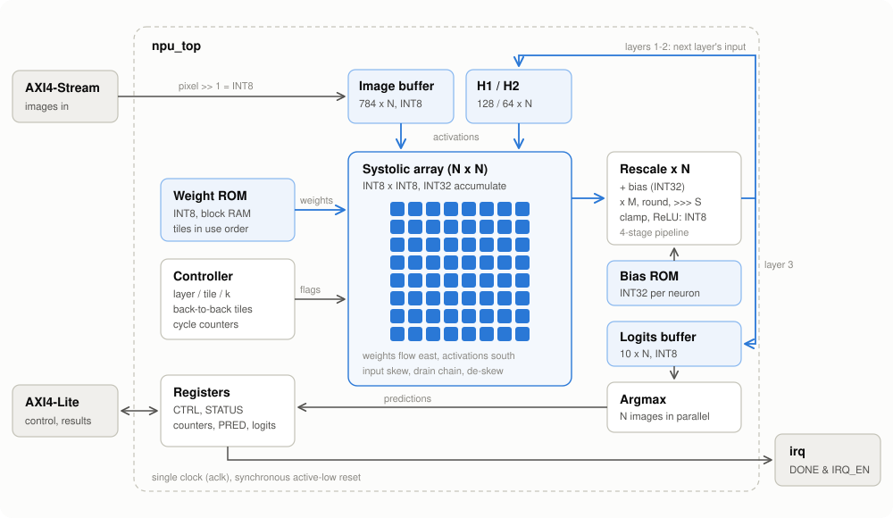
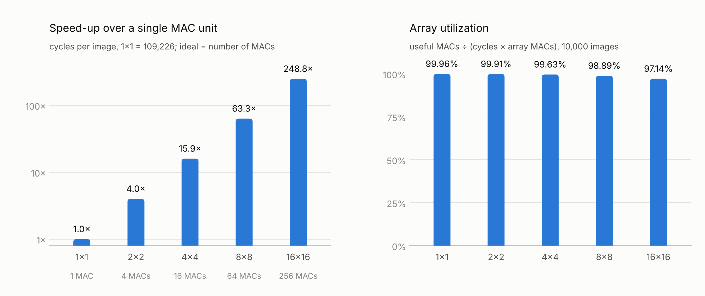

# TinyNPU: an INT8 neural-network accelerator in SystemVerilog


TinyNPU is a small neural processing unit that runs a 784-128-64-10 neural network (MNIST handwritten digits) in hardware. At its core is a parameterized **N x N output-stationary systolic array** of INT8 multiply-accumulate units. Around it are on-chip weight memory, a hardware rescaling (requantization) pipeline, ReLU and argmax, plus **AXI4-Lite** control and **AXI4-Stream** image input.

Every logit the hardware computes is checked **bit for bit** against an integer Python model, on all 10,000 MNIST test images, at every array size from 1x1 to 16x16.

## Highlights

| | |
|---|---|
| Network | 784 → 128 → 64 → 10 MLP, trained from scratch in NumPy, post-training INT8 quantization |
| Accuracy | **97.98 %** INT8 in hardware (float model: 97.90 %) on the 10,000-image MNIST test set |
| Bit-exactness | **0 mismatches** in 50,000 simulated inferences (10,000 images x 5 array sizes) |
| Performance (8x8) | **1,725 cycles per image**, **98.9 %** of the array's MAC slots doing useful work |
| Scaling | **63.3x** (8x8) and **248.8x** (16x16) faster than a single MAC unit, utilization ≥ 97 % |
| Verification | cocotb unit tests, full-system SystemVerilog testbench, 17 SVA assertions with a self-test, 3 simulators, GitHub Actions CI |
| FPGA | Placed and routed on an Artix-7 (xc7a35t): **timing met at 100 MHz**, Fmax **109.4 MHz**, 80 DSP48 slices, 15 % of LUTs, **about 58,000 images/s** (see [FPGA results](#fpga-implementation-artix-7)) |

## Architecture



**Dataflow.** A layer with K inputs and M outputs is split into tiles of N output neurons. For tile t, row i of the array receives the weights `W[t*N+i][k]` and column j receives image j's activations `x_j[k]`, for k = 0 … K-1. After K cycles, PE(i,j) holds the dot product for neuron t*N+i of image j. So one tile computes N neurons for N images at once (N² MACs per cycle).

**Back-to-back tiles.** Each PE copies its finished sum into a result register one cycle after the tile's last element, so the next tile can start streaming in the very next cycle. Results leave through a per-column drain chain, are de-skewed so each row comes out as one vector, and go through N parallel rescale lanes. Within a layer the array never idles. The only gaps are the pipeline drain between layers (about 3N + 10 cycles) and the 10-cycle argmax.

**Cycle budget, 8x8 array, one batch of 8 images:**

| Layer | Tiles x K | Array cycles |
|---|---|---|
| 784 → 128 | 16 x 784 | 12,544 |
| 128 → 64 | 8 x 128 | 1,024 |
| 64 → 10 (padded to 16) | 2 x 64 | 128 |
| pipeline drains, argmax, control | | 105 |
| **total** | | **13,801** (1,725 per image) |

**Quantization** (symmetric, per tensor; see [`model/quantize.py`](model/quantize.py)):

```
input        x0 = pixel >> 1                        (0..127)
layer        acc = sum_k W[n][k] * x[k] + B[n]      (INT8 x INT8, INT32 accumulate)
rescale      y = clamp((acc * M + 2^(S-1)) >>> S)   (M / 2^S ≈ s_w * s_in / s_out)
             ReLU on hidden layers, INT8 logits on the output layer
prediction   argmax of the 10 logits (lowest index wins a tie)
```

The largest accumulator value over the whole test set is 323,809 (20 bits), well inside the 32-bit accumulators.

## Results

### Performance and scaling

The array size N is a single parameter. All five sizes were simulated on the full test set:

<picture>
  <source media="(prefers-color-scheme: dark)" srcset="docs/scaling_dark.png">
  
</picture>

| Array | MACs | Cycles / image | Speed-up | Utilization | Mismatches (10,000 images) |
|---|---|---|---|---|---|
| 1 x 1 | 1 | 109,226 | 1.0x | 99.96 % | 0 |
| 2 x 2 | 4 | 27,321.5 | 4.0x | 99.91 % | 0 |
| 4 x 4 | 16 | 6,849.2 | 15.9x | 99.63 % | 0 |
| **8 x 8** | **64** | **1,725.1** | **63.3x** | **98.89 %** | **0** |
| 16 x 16 | 256 | 439.1 | 248.8x | 97.14 % | 0 |

Utilization = useful MACs (109,184 per image) ÷ (cycles x N²). Data: [`docs/results/scaling.csv`](docs/results/scaling.csv).

### FPGA implementation (Artix-7)

Out-of-context synthesis, placement and routing with Vivado 2023.2 ([`fpga/synth.tcl`](fpga/synth.tcl)), 8x8 array on an xc7a35t (the chip on the Basys 3 and Arty A7-35T boards):

| Metric | Result |
|---|---|
| Clock target | 100 MHz (10 ns), **met** with 0.863 ns worst slack |
| Maximum clock (Fmax) | **109.4 MHz** |
| LUTs | 3,150 / 20,800 (15.1 %) |
| Flip-flops | 6,399 / 41,600 (15.4 %) |
| Block RAM tiles | 36.5 / 50 (73 %): weight ROM, bias ROM, activation buffers |
| DSP48 slices | 80 / 90 (89 %): 64 for the MAC array, 16 for the 8 rescale lanes |
| Throughput | **57,967 images/s** at 100 MHz, 63,417 images/s at Fmax |
| On-chip power | 0.309 W (Vivado vectorless estimate), about 5.3 µJ per image at 100 MHz |

Vivado inferred one DSP48 multiply-accumulate per PE and block RAM for every memory, and reported 0 critical warnings and 0 errors. The run is out of context (no board pins, ideal clock), so the Fmax is a pre-board estimate. Summary: [`docs/results/vivado_N8_summary.txt`](docs/results/vivado_N8_summary.txt).

## Verification

| Level | What is checked | Tool |
|---|---|---|
| Unit: systolic engine | random INT8 tiles (2x2, 4x4, 8x8), back to back and with gaps, extreme values (-128 x -128), real layer shapes, against numpy | cocotb + Icarus |
| Unit: rescale lane | 3,000 random cases, every rounding edge of the trained M/S values, saturation, against the golden formula | cocotb + Icarus |
| Full chip | real MNIST batches through AXI4-Stream/AXI4-Lite, every logit vs the golden model | cocotb + Icarus |
| System | all 10,000 test images, every logit and prediction bit-exact, register map, error responses, random stream gaps | SystemVerilog testbench, Verilator and Vivado xsim |
| Protocol and invariants | 17 SVA assertions: AXI4-Lite/AXI4-Stream handshake stability, legal responses, BUSY/DONE rules, interrupt, feeder range, writer range, tile-length rule | SVA via `bind` |
| Assertion self-test | a deliberate stream protocol violation must be caught | `+SVA_SELFTEST` |
| Lint | `verilator --lint-only -Wall`, 0 warnings at every array size | Verilator |
| CI | everything above (except Vivado) on every push | GitHub Actions |

The golden model ([`model/golden.py`](model/golden.py)) performs exactly the hardware's integer arithmetic, so a correct design must match it bit for bit, not just get the same predictions.

**Vivado simulator, 8x8 array, all 10,000 test images** (full log: [`docs/results/xsim_N8_10000.log`](docs/results/xsim_N8_10000.log)):

```
==== Summary ====
  Array                  : 8 x 8 (64 MAC units)
  Images                 : 10000
  Accuracy (vs labels)   : 97.98% (9798 / 10000)
  Logit mismatches       : 0 (vs bit-exact golden model)
  Prediction mismatches  : 0
  Cycles per batch       : 13801.0
  Cycles per image       : 1725.1
  Array utilization      : 98.9% (useful MACs / (cycles x 64))
  Feed efficiency        : 99.2% (cycles the array received data)
  Throughput @ 100 MHz   : 57967 images/s
  Assertion failures     : 0
*** TEST PASSED ***
```

## Register map and stream format

| Address | Name | Access | Description |
|---|---|---|---|
| 0x000 | ID | RO | `0x4E505531` ("NPU1") |
| 0x004 | CONFIG | RO | [7:0] N, [15:8] layers, [31:16] input size |
| 0x008 | CTRL | RW | [0] START (self-clearing), [1] IRQ_EN |
| 0x00C | STATUS | RO | [0] BUSY, [1] DONE, [2] IMG_READY, [3] STREAM_ERR |
| 0x010 | CYCLES | RO | clock cycles of the last inference |
| 0x014 | MAC_CYCLES | RO | cycles in which the array was fed |
| 0x018 / 0x01C | PRED0 / PRED1 | RO | predicted digit of images 0-7 / 8-15, 4 bits each |
| 0x020 | RUNS | RO | completed inferences |
| 0x400 + 64j + 4n | LOGITS | RO | logit n of image j, sign-extended |

**Image stream.** One beat per pixel position, 784 beats per batch. Byte j of beat k is pixel k of image j (raw 8-bit grey level). TLAST goes on beat 783. TREADY is low while an inference runs.

**Use.** Stream a batch, write CTRL = 3 (START + IRQ_EN), wait for `irq`, then read PRED0/PRED1.

## How to run

**Windows with Vivado** (2023.2 tested). Open Command Prompt in the repository:

```
cd sim
run.bat                     :: 8x8 array, all 10,000 images, bit-exact check
run.bat 16 10000            :: 16x16 array
run.bat 8 1000 SVA_SELFTEST :: assertion self-test
sweep.bat                   :: every array size, prints the scaling table
wave.bat                    :: one batch in the simulator GUI
cd ..\fpga
synth.bat                   :: synthesis + place and route, writes fpga\build_N8\reports\summary.txt
```

**Linux with Verilator 5.0xx and Icarus Verilog 12:**

```
tools/lint.sh                       # Verilator lint, every array size
tools/run_verilator.sh 8 10000      # all 10,000 images on the 8x8 array
cd cocotb && pytest -v test_runner.py
```

**Retrain and re-quantize** (needs only NumPy; MNIST downloads automatically):

```
python model/train.py       # float model, about 1 minute
python model/quantize.py    # INT8 model, weight/bias ROM images, test vectors, npu_model_params.svh
```

## Repository layout

```
rtl/      npu_top          AXI4-Lite + AXI4-Stream wrapper
          npu_axil_regs    register file
          npu_core         controller, buffers, write-back, argmax
          npu_gemm         input skew + systolic array + output de-skew
          npu_array        N x N grid of PEs and drain chains
          npu_pe           INT8 MAC processing element
          npu_requant      bias + fixed-point rescale + clamp/ReLU
          npu_rom / npu_ram / npu_delay
tb/       tb_npu.sv        full-system testbench
          npu_sva.sv       assertions, attached with bind
cocotb/   unit and full-chip Python tests
model/    training, quantization and the bit-exact golden model
mem/      weight/bias ROM images per array size, test images, expected results
sim/      Vivado simulator scripts (Windows)
fpga/     Vivado synthesis and implementation script
tools/    Verilator scripts, chart generator
docs/     diagram, charts, result data
```

## Possible extensions

- Double-buffer the image buffer so the next batch streams in during computation.
- Pack two INT8 MACs into each DSP48 to halve the DSP count.
- Per-channel weight scales (one M per neuron, passed alongside the bias).
- Convolution layers via an im2col address generator in front of the same array.
